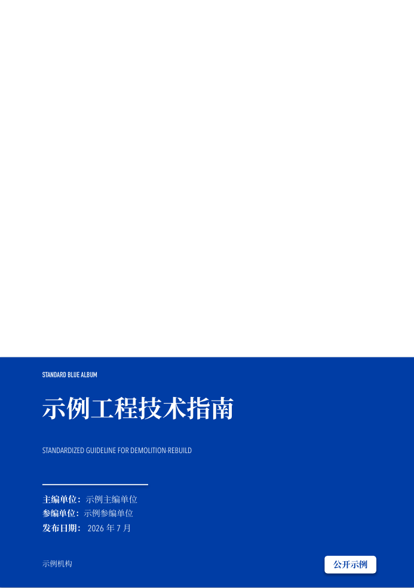
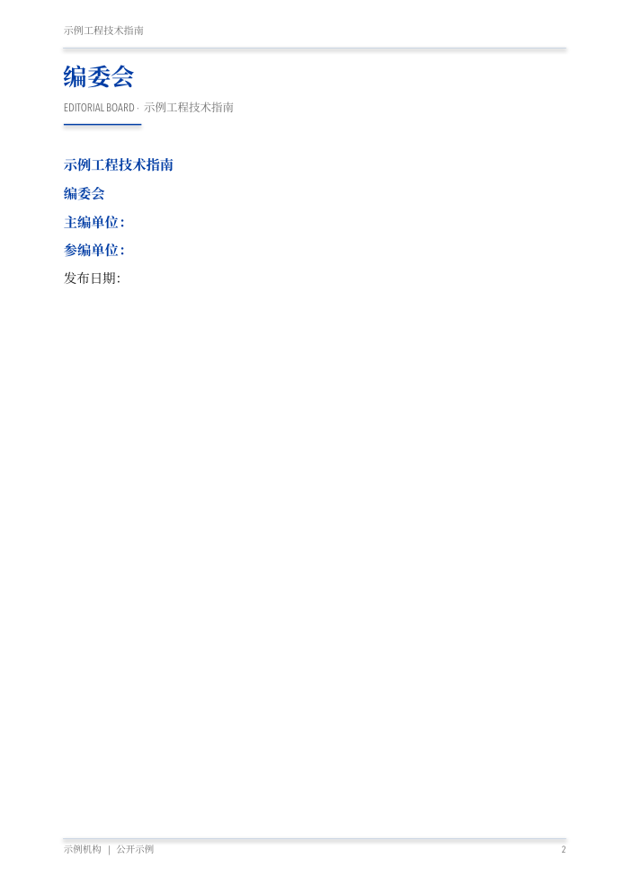
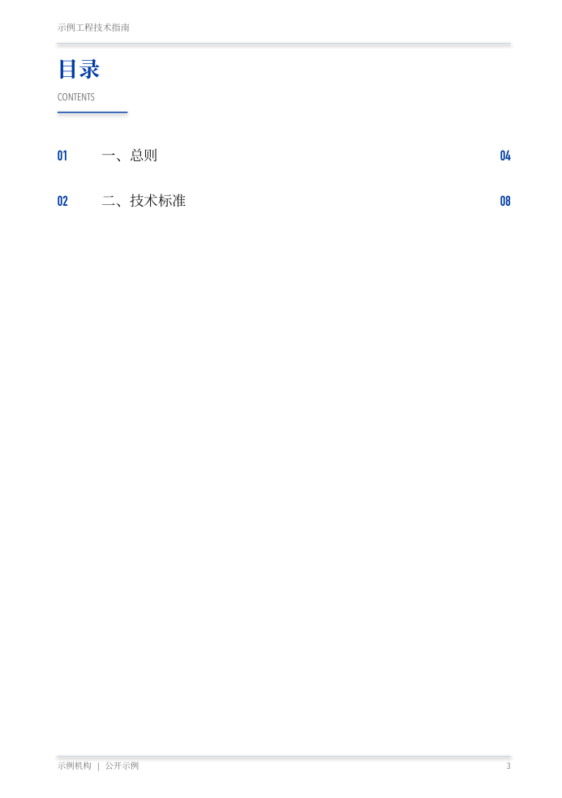
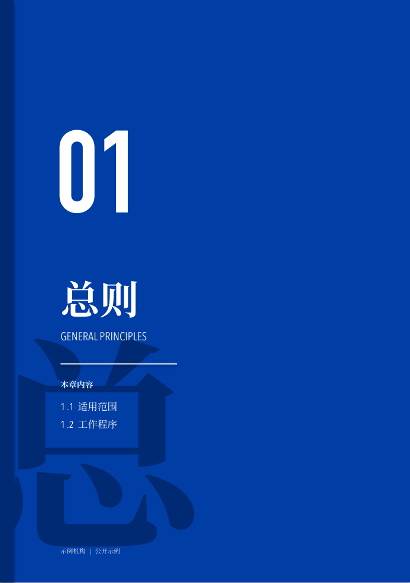
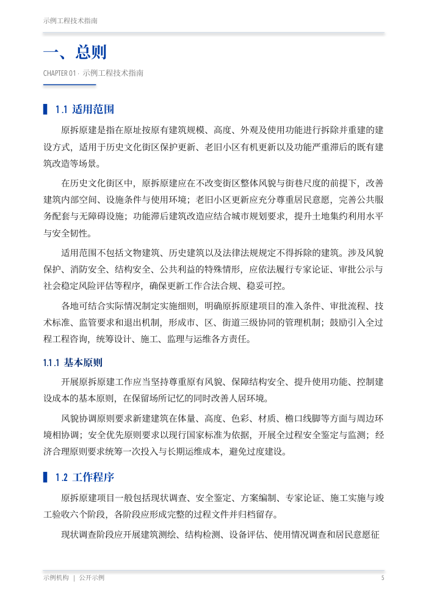
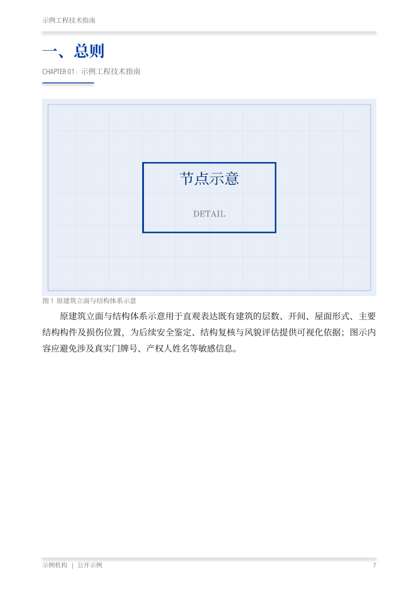
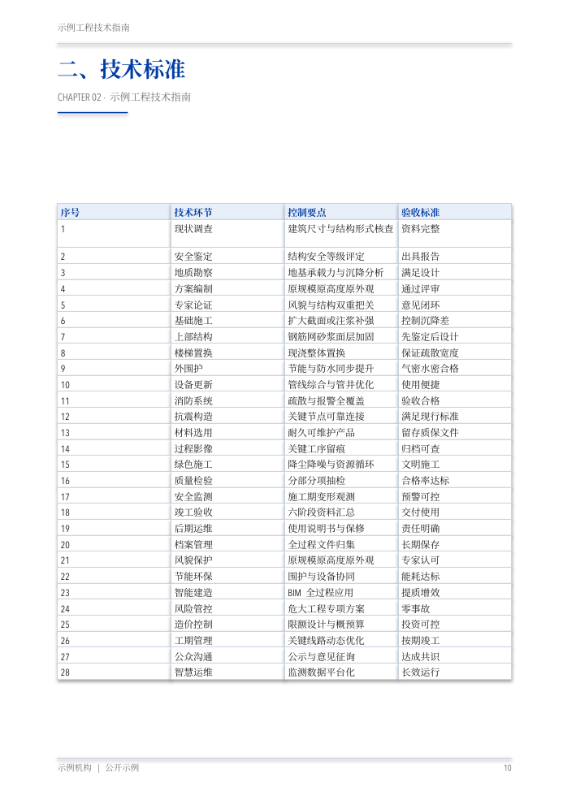
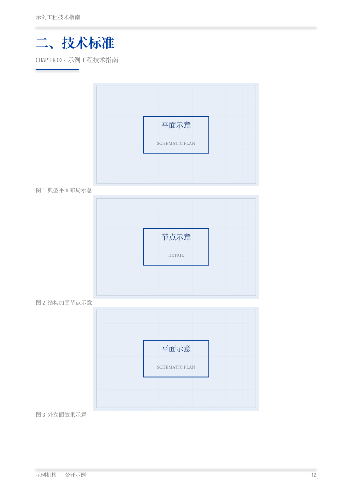

# 标准蓝画册排版设计系统

> **适用范围**：本规范规定工程技术类画册、业务标准化指南、专业手册等成册文档的版式设计要求、组件构成、排版硬规则与质量验证流程，并提供配套的可复用排版引擎。
> **基本形制**：B5（176×250mm，默认）或 A4；正文单栏或双栏；封面与章节页采用标准蓝全出血版式。
> **使用原则**：新建画册以本规范为默认设计体系；已有成品修订以用户指定的源文件、字体、栏式、固定行距和保留版式要求为准，不用默认令牌覆盖已确认设计。

---

## 0. 设计理念

- **主色统领、内文克制**：封面与章节页采用标准蓝全出血底彰显品牌识别；内文以白底承载信息，默认**单栏**，保证连续阅读、图文呼吸感和长句可读性。信息密集且明确要求分栏时可选**双栏**。单／双栏由 `columns` 选项切换，几何与成本模型自动适配（见 §1.3、§6.4）。
- **网格精确、零溢出**：所有几何以 **cm 浮点**为唯一单位，仅在辅助函数内做一次 `Cm()` 换算，杜绝 EMU 坐标误用。
- **两端对齐、标点不悬挂**：正文采用 `PP_ALIGN.JUSTIFY`，且每个段落**必须关闭标点悬挂**（`hangingPunct="0"`），否则中文标点溢出文本框，导致右缘参差。
- **逐页版心施检**：排版结果必须渲染为 PDF 后按行 bbox 断言，纯 XML／对齐检查无法发现溢出。

---

## 0.1 研究报告默认为对外分享稿

**默认受众是外部读者。** 用户委托研究报告、调研报告或技术选型报告时，直接交付可独立阅读、可对外分享的正式稿；用户明确要求内部工作记录时才采用内部稿。

正式稿的内容契约：研究结论、必要的方法与范围、事实和证据、比较分析、技术风险、建议以及正式参考来源。编制者执行过程、个人环境、排版过程与交付验收属于独立工作记录，不进入报告。

- 封面、导读、正文、图表和附录使用一致的外部读者语气；将“当前用户/你的项目/本机/本轮任务”改为适用行业、业务场景、平台或技术对象。
- 对外成品无注释：清除脚注式补充说明、括号内的编制说明、反复自我声明、编辑提示、批注、修订标记、隐藏评语及演讲者备注。用户要求“删除所有注释”时，连同页眉页脚、图注与附录中的内部说明一并检查；图表仅保留正式名称、坐标/单位和必要数据标识。
- 研究方法与证据强度集中写为正式正文。事实尚待验证时保持准确状态，技术限制继续保留为分析内容；不把“删除注释”变成“把未知写成已验证”。
- 参考文献与可核查的公开来源是正式报告内容。集中使用专业标题与链接，不使用“点击查看”“本地快照”“见交付文件”等操作提示；保留来源链接，不将 PDF 的链接对象误当作批注删除。
- 对外 PDF/PPTX/Markdown 及分享附录不出现本机绝对路径、账号、授权记录、采集错误、脚本日志、QA/PASS 汇报或尚未完成的工作清单。这些材料在独立内部目录保存，和分享包分离。

改版先保留旧稿，再生成递增版本。交付前同时检查 Markdown、PPTX 正文/备注/批注以及最终 PDF 的文字和批注对象；完成对外内容检查后仍须执行 §6 排版审计。

---

## 0.2 Skill 公开发布的隐私边界

公开包只包含可复用规范、通用代码、测试与虚构样张。发布前逐项核对源文件、图片、PPTX 解包内容及作者元数据；不打包客户原稿、真实项目案例、本机路径、账号、凭证、日志、系统字体或内部审计记录。样张从中性数据重新生成，不依赖黑条、隐藏对象或删除可见署名来脱敏。

Git 历史也是公开内容。若旧历史含个人署名、私人邮箱或内部信息，采用独立干净快照和中性提交身份，原仓库保持私有；不得仅清理最新文件后直接将旧仓库改为公开。公开可访问与开源许可是两件事，未获许可选择授权时不擅自附加开源许可证。发布后回读实际可见性、提交历史和文件清单。

## 0.4 先区分新建、重排与局部修订

| 任务 | 执行方式 |
|---|---|
| 从内容新建画册，设计参数尚未确定 | §0.5 澄清后使用默认引擎 |
| 已有原生PPTX固定行距、单/双栏重排，处理异常留白或续表 | 先读 [原生重排与成册修订](references/native-reflow-and-pdf-revisions.md) §1–4；保留源对象与内容映射 |
| 保持正文不变，合入参考封面、目录、封底 | 同一参考 §5；直接合并PDF页并更新页码映射，不重新排正文 |
| 只改出版年月或局部字样 | 同一参考 §6；定位语义页，局部修改并逐页做差异核验，不顺带重排、删扉页或改目录 |

下文固定字体、cm网格、比例行距、双栏目录、短段单栏收尾等，是默认新建引擎的约定。保留原稿模式使用原稿约定；PDF采用pt、OOXML采用EMU时显式换算，不混用单位。

## 0.5 新建设计的需求澄清

> 新建画册且设计参数尚未明确时，先使用 **brainstorming** 澄清影响结果的选择，不直接套默认参数。
> 用户已确定方案、要求继续修订或只改局部文字时，沿用现有共识直接执行；不重复询问已确定的八项参数。“按默认配置”也可直接出稿。

### 需求聚焦清单

brainstorming 为通用流程，不预设本规范的领域。调用时应引导其重点澄清以下 8 项（一次一问、多选优先），澄清结论最终收敛为引擎 `options`（见 §5）：

| # | 维度 | 可选项（⭐＝推荐默认） | 映射到 `options` |
|---|---|---|---|
| 1 | **栏式** | ⭐单栏 ／ 双栏 | `columns=1` ／ `2` |
| 2 | **正文字体** | ⭐思源宋体 ／ 微软雅黑 ／ 黑体 ／ 指定字体名 | `body_font` |
| 3 | **成册规格** | ⭐B5(176×250) ／ A4(210×297) ／ 自定义(cm 元组) | `page_size` |
| 4 | **内容来源** | 已有 Word／文本（须先抽 blocks）／ 从零按大纲生成 ／ 已给 blocks | 决定前置抽取步骤 |
| 5 | **画册名称与落款** | 书名、英文书名、版次、编制单位、密级标注 | `book_title` 等，见 §1.5 |
| 6 | **封尾标语** | 两行主题标语（如"匠心筑造／品质焕新"）；缺省回退书名 | `slogan=("…","…")` |
| 7 | **主色** | ⭐标准蓝 #003DA5 ／ 自定义 HEX | 需改引擎常量 |
| 8 | **交付方式** | ⭐直接生成 pptx ／ 先出样张确认 | 控制是否先打样 |

### 与 brainstorming 的衔接

- brainstorming 的通用终态是 `writing-plans`；本规范属参数化套版，需求澄清后**即直接 build**，无须进入写作计划流程。
- 将委托方选择收敛为 `options` 字典及必要的前置步骤（如 Word→blocks 抽取），调用 `build_album(..., options=options)`。
- 执行 §6 审计，全项 PASS 方可交付；若选择"先打样"，应先导出样张送审。

> **能力边界**：`columns`、`page_size`、字体栈四件套、品牌文案令牌（§1.5）均已内置，可直接生效；
> "图表混排策略""封面构图""主色"为规范固定值，变更须修改 `references/b5_album_engine.py` 并同步本规范，属二次开发，不得在首轮澄清中擅自变动。

---

## 0.6 版式参考图（样张）

仓库 `samples/layouts/` 提供按本规范渲染的九类页面样图，以单栏 B5 原拆原建风格示例，
样张全部使用虚构示例信息，不含真实项目资料：

| 版式 | 样图 | 说明 |
|---|---|---|
| 封面 |  | 全出血蓝底、书名、出版信息（已脱敏）、密级标注 |
| 编委会 |  | 书名、编委会条目 |
| 目录 |  | 单栏目录，序号/章名/页码 |
| 章节页 |  | 全出血章节分隔页 |
| 正文页 |  | 单栏正文、标题层级、页眉页脚 |
| 图文混排 |  | 通栏图/表置顶 + 下方栏区承接正文 |
| 表格页 |  | 超大表格独立成页，浅蓝表头、网格线 |
| 图库页 |  | 连续图片组合排布 |
| 封尾 |  | 全出血蓝底 + 主题标语 + 机构落款 |

生成脚本见 `samples/make_layout_preview.py` 与 `samples/assemble_layouts.py`。

---

## 1. 设计令牌（Design Tokens）

### 1.1 色板

| 名称 | HEX | 用途 |
|---|---|---|
| `BLUE` | `#003DA5` | 主色：标题、二级标题竖条(▍)、目录序号／页码、页眉主标 |
| `BLUE_D` | `#002A73` | 深蓝：章节页底色叠层、三级标题、装饰竖条、水印字 |
| `BLUE_LT` | `#E9EFF8` | 浅蓝：表头底、封面副文、章节页英文与本章内容 |
| `INK` | `#1A1A1A` | 正文墨色（非纯黑，利于长时阅读） |
| `GRAY` | `#6E6E6E` | 页眉小字、页脚、图注、英文眉题 |
| `RULE` | `#C9D4E3` | 分隔线与表格描边（浅蓝灰） |
| `WHITE` | `#FFFFFF` | 章节页文字、封面标题 |

**配色纪律**：全册配色限于上述六色，不得引入规范外杂色。

### 1.2 字体栈（macOS 优先，跨平台降级）

- `TITLE_F = "Source Han Serif CN"` —— 思源宋体：**章节分隔页大标题、页眉主标题**（品牌宋体）
- `COVER_F = "Source Han Serif CN"` —— 思源宋体：**封面主标题、目录章名、编委会正文、封尾主标语**（封面区衬线字体，与人工版一致）
- `HEI = "Source Han Serif CN"` —— 黑体：**各级小标题、表格表头、页脚、序号、英文、封面标签与单位名**（缺失时降级 `"Microsoft YaHei"` ／ `"SimHei"`）
- `BODY = "Source Han Serif CN"` —— 思源宋体：**正文段落默认字体，单栏与双栏一致**；显式指定 `body_font` 时采用指定值，保留原稿的修订任务不自动换字。
- `SONG = "Source Han Serif CN"` —— 宋体：**图注、表格非表头单元、跨页页脚**（缺失时降级 `"SimSun"`）

> **实现要点**：python-pptx 设置字体必须同时写 `run.font.name` 与 `rPr/a:ea`、`rPr/a:cs` 的 `typeface`，否则 CJK 字符回落到默认字体。见引擎 `set_cjk()`。

> ⚠️ **`body_font` 覆盖引擎 `BODY`（高频错误）**：`options={"body_font": X}` 会在构建时**覆盖**模块级 `BODY` 常量（见 `_options_scope`）。仅改 `BODY` 而不改 `options["body_font"]`，正文不会变。变更正文字体必须同步确认构建脚本中 `options["body_font"]` 的取值。

> **默认字体可用性**：新建前确认思源宋体已安装，缺失时说明并确认替代方案，不将 `Source Han Serif CN` 静默当作思源宋体。下文容量常数与旧样张来自历史字体配置，切换后的具体文稿仍须渲染校验；默认值测试通过不等于任意整册版面已通过。

### 1.3 几何网格（B5 = 176×250mm）

```
PW, PH        = 17.6, 25.0      # 页面宽高(cm)
ML (左页边)   = 1.8             # 版心左缘
MR (右页边)   = 1.6
CONTENT_W     = 14.2            # 版心宽 = PW - ML - MR
COL_W         = 6.67            # 单栏宽（双栏时）
COL1_X        = 1.8             # 左栏左缘
COL2_X        = 9.32            # 右栏左缘 (= ML + COL_W + GAP)
DIV_X         = 8.89            # 双栏分隔线 x (= 左栏右缘 + 0.22)
GAP           = 0.85            # 栏间距
TOP           = 4.2             # 版心顶（页眉压缩版）
CONTENT_H     = 19.2            # 版心高 = PH - TOP - 1.6(底)
CONTENT_BOTTOM= 23.62           # 正文栏底目标 y：紧贴 23.7 页脚线，留 0.1cm 安全缝
LINE_CM       = 0.71            # 正文行"首→尾"有效推进（含 CJK 行框与标题段距）
SAFE          = 0.35            # 栏高安全余量：吸收 CJK 行框与两端对齐方差
CAP_CM        = (CONTENT_BOTTOM - TOP) - SAFE   # 每栏可用高度（≈19.07cm ≈ 27 行），单／双栏同高
```

`BODY_CPL`／`EST_CPL`／`FILL_BONUS` 随栏数自适应，由 `_apply_geometry` 按 `columns` 覆写：

| 栏式 | `BODY_CPL` | `EST_CPL` | `FILL_BONUS` |
|---|---|---|---|
| 双栏（COL_W=6.67cm） | 18 | 17.5 | 0.5 |
| 单栏（COL_W=14.2cm） | 38 | 37 | 1.2 |

> 混排页常量：`BAND_GAP=0.40`、`IMG_BAND_MAX=0.62`、`TBL_BAND_MAX=0.80`、`MIN_BELOW_H=5.5`。
> 段后距：`SA_BODY=0.0`、`SA_H2=0.10`、`SA_H3=0.08`、`SA_H4=0.06`（cm）。`SA_BODY=0` 使正文段落仅以首行缩进区分，形成密集书籍样式。

### 1.4 字号／行距／段距

| 元素 | 字号 | 字体／色 | 行距 | 段距 |
|---|---|---|---|---|
| 页眉书名 | 8pt | HEI／GRAY | — | — |
| 页眉主标题 | auto-fit ≤19pt | TITLE_F／BLUE | — | — |
| 英文眉题 | 9pt | HEI／GRAY | — | — |
| 章号（章节页） | 140pt | HEI／WHITE | — | — |
| 章节标题 | auto-fit 24–48pt | TITLE_F／WHITE | — | sb 8pt |
| 本章内容英文 | 14pt | HEI／BLUE_LT | — | — |
| 本章条目 | 12pt | SONG／WHITE | 1.5 | — |
| **二级标题** ▍ | 12.5pt | HEI／BLUE | 1.15 | sb 10pt ／ sa 4pt |
| **三级标题** | 11.5pt | HEI／BLUE_D | 1.15 | sb 8pt ／ sa 3pt |
| **四级标题** | 10.5pt | HEI／INK | 1.15 | sb 6pt ／ sa 2pt |
| **正文** | 10.5pt | BODY／INK | 1.45–1.55 | sa 4pt ／ 首行缩进 2 字符 |
| 编号段 | 10.5pt | 标号 HEI ＋ 正文 BODY | 1.45 | sa 4pt ／ 首行缩进 |
| 表格表头 | 8.5pt | HEI／BLUE（加粗） | 1.15 | — |
| 表格单元 | 8.5pt | SONG／INK | 1.12 | — |
| 图注 | 8pt | SONG／GRAY | — | — |
| 页脚 | 7.5pt | HEI／GRAY | — | — |
| 目录条目 | 12.5pt | 序号 HEI 蓝／章名 COVER_F 墨／页码 HEI 蓝 | — | 条距 1.42cm |
| 封面副文 | 9–12pt | HEI／BLUE_LT、COVER_F／WHITE | — | — |

> **auto-fit 公式**（单行标题按字数缩字号）：`fs = max(min_pt, min(max_pt, max_w_cm / (chars*0.0353*1.06)))`，1pt≈0.0353cm/汉字宽。

### 1.5 品牌文案令牌（必须逐项赋值）

引擎不得在渲染函数内写死任何具体项目的书名、标语或单位名。以下令牌全部可由 `options` 覆盖，**每次新建画册均应逐项确认**：

| 常量 | `options` 键 | 缺省值 | 出现位置 |
|---|---|---|---|
| `BOOK_TITLE` | `book_title` | `"标准蓝画册"` | 页眉书名行、封面主标题、编委会眉题 |
| `BOOK_TITLE_EN` | `book_title_en` | 空（不渲染） | 封面英文副行 |
| `BOOK_EDITION` | `edition` | 空（不渲染） | 封面版次／批次标注 |
| `BRAND_LINE` | `brand_line` | `"STANDARD BLUE ALBUM"` | 封面品牌行 |
| `ORG_NAME` | `org_name` | `"示例机构"` | 页脚、封面落款、封尾落款 |
| `DOC_CLASS` | `doc_class` | `"公开示例"` | 密级标注（置空则不渲染） |
| `SLOGAN` | `slogan` | 空元组（回退书名） | 封尾两行主题标语 |

> ⚠️ **交付前必查**：未覆盖 `book_title`／`slogan` 即交付，会把缺省文案或上一册的标语带入新画册，属重大交付事故。

---

## 2. 页面类型体系（9 类）

| 类型 | 版式 | 触发 |
|---|---|---|
| `cover` | 全出血背景图 ＋ 底部蓝条块 ＋ 书名／英文／编制单位／密级标注 | 第 1 页 |
| `blank` | 留白扉页 | **默认关闭**，`options={"add_blank": True}` 时插入 |
| `colophon` | 白底编委会（主编／参编单位、发布日期） | 封面之后 |
| `toc` | **双栏**制表位目录（序号▏章名▏页码） | 编委会之后 |
| `chapter` | 全出血蓝底 ＋ 大章号 ＋ 章标题 ＋ 本章内容 6 条 | 每章起始 |
| `content` | 页眉 ＋ 单／双栏正文（含栏内图） ＋ 分隔线 ＋ 页脚自动页码 | 主体 |
| `table` | 页眉 ＋ 全宽表格（含续表）；小表在版心内垂直居中 | 超大表（下方不足 5.5cm）方独立成页 |
| `hybrid` | 页眉 ＋ **通栏图／表置顶** ＋ 下方栏区正文（高度自动缩短） | 单图始终混排；表不高时混排 |
| `gallery` | 页眉 ＋ **多图竖向堆叠网格**置顶 ＋ 下方栏区正文 | 数据流中出现**连续 ≥2 个 image 块** |
| `back_cover` | 全出血蓝底 ＋ 主题标语／落款 | **末页，默认生成** |

**分页顺序契约（动态计算，不得写死）**：

```
fp = 1 + (1 if add_blank else 0) + 1 + 1     # 封面 + 可选扉页 + 编委会 + 目录
```

正文与章节 folio 自 `fp+1` 起递增，末页固定为 `back_cover`。

> ⚠️ 若将前导页写死为 `['cover','blank','colophon','toc']`，一旦关闭扉页即导致 folio 与实际页序错位一页。变更扉页开关时，**必须同步 folio 起算式与 `page_types` 写入顺序**，否则审计脚本按页型跳过时会整体错位。

---

## 3. 排版组件库

### 3.1 封面（全出血）

- 背景图按 `add_picture(0,-3.03,20.71,30.26)` 偏移裁切出血。
- 底部蓝矩形 `add_rect(0,15.2,17.6,9.8,BLUE)` 承载文字区。
- 层次顺序：品牌行（9pt,HEI,BLUE_LT）→ 主标题（29pt,COVER_F,WHITE）→ 英文书名（9.5pt）→ 版次（12pt）→ 白细线 → 主编／参编／日期（10–10.5pt，HEI 蓝标 ＋ COVER_F 浅蓝）→ 落款（9pt）→ 右上圆角密级标注（白底蓝字）。
- 无背景图时自动回退为纯蓝底封面。

### 3.2 目录（双栏制表位对齐）

- 采用**双栏**布局，按章数均分，栏间距与正文双栏一致。
- 每栏单文本框单段落：序号（`%02d`,HEI 蓝）`\t` 章名（COVER_F 墨）`\t` 页码（`%02d`,HEI 蓝）；制表位 `pos=1.2cm(l)`、`pos=6.0cm(r)`。
- 双栏目录较单栏节省近 50% 纵向空间，且更符合专业画册观感。

### 3.3 章节页（全出血蓝 ＋ 大章号）

- `add_rect(0,0,17.6,25.0,BLUE)` ＋ 左侧 `add_rect(0,0,0.6,25.0,BLUE_D)` 装饰条。
- 巨型水印字（章名首字，280pt，BLUE_D）。
- 大章号 `%02d`（140pt，HEI，WHITE）。
- 章标题（auto-fit 24–48pt，TITLE_F，WHITE）＋ 英文眉题（14pt，BLUE_LT）。
- 白细线 ＋ "本章内容" ＋ 本章前 6 条（12pt，SONG／WHITE，行距 1.5）。

### 3.4 正文页（content，单／双栏自适应）

- 页眉：书名（8pt,GRAY）→ 细线（RULE）→ 主标题（auto-fit ≤19pt,TITLE_F,BLUE）→ 英文眉题（9pt,GRAY）→ 蓝短条（2.2×0.04cm）。
- **双栏**：左栏 `COL1_X`、右栏 `COL2_X`，中缝分隔线 `DIV_X`（仅版心高，不穿页眉页脚）。
- **单栏**：整页一个通栏文本块，x=`COL1_X`、宽=`CONTENT_W`，**不绘制**中缝分隔线。
- 每栏为**单文本框流式段落**（避免叠字）：标题竖条 `▍ `、编号段黑体标号、首行缩进 2 字符、两端对齐。
- 栏内图占满单栏宽，下方附图注（8pt,GRAY）。
- `render_content_v2` ／ `render_hybrid` ／ `fill_below` 均按 `range(NCOLS)` 自适应，渲染层无须为单栏另写。

### 3.5 表格页（table）

- 表头行 `BLUE_LT` 底 ＋ HEI 蓝加粗；单元 `WHITE` 底 ＋ SONG 墨；描边 `RULE` 0.5pt。
- 单元高按字数与内嵌图动态计算（`cell_h`）；超高表自动分块并标注"（续表）"。
- 独立表页时表格在版心内垂直居中，避免上挤下空。

### 3.6 图文／表混排（hybrid）

- **图始终与正文混排**：通栏图置顶 ＋ 下方栏区正文，不生成独占图页。
- **表在能放下时混排**：表带高 `min(真高×1.12+0.7, CONTENT_H*0.80)`；仅当下方剩余栏区 **< `MIN_BELOW_H`(5.5cm)** 时才退回独立 `table` 页。
- 图带高 `min(CONTENT_W/aspect, CONTENT_H*0.62)`。
- 分隔线仅绘于下方栏区（`below_top = TOP + band_h + BAND_GAP`），不穿越通栏带。
- **严禁成本裁剪**：下方栏容量小，不得将超容块硬塞（`min(cost, cap_cm)` 会导致正文被截断压底）。放不下即停止，交还主循环续页。
- 按缩短后的栏高拆分段落（`split_long_para(b, max_cm=cap_cm)`），使混排栏亦能填满。
- **表前小标题占正文版心，不占页眉空隙**：当待排正文只有一个标题且下一块为小表，引擎将标题作为 `lead_heading` 与表格一起排版。标题从 `TOP` 开始，按字号、版心宽度和换行数预留 `hybrid_lead_height()`；表格及下方正文整体顺延，同一高度同时从分页容量扣除。不得在分页结束后用固定 y 坐标把标题补进页眉、眉题或装饰短线区。
- 标题过长或标题＋表格无法满足混排容量时，按正常分页处理，不覆盖页眉或靠缩字号强塞。`page_types.below_top` 必须使用包含标题占高的真实位置。

### 3.7 图库页（gallery）

- **触发**：`paginate` 遇 `image` 块时向前贪心收集**连续 image run**；`n==1` 走 `hybrid`，`n>=2` 走 `gallery`。
- 图带高 `band_h = CONTENT_H * 0.90`；每图槽位 `slot = (band_h - 0.15*(n-1)) / n`，图高 `min(CONTENT_W/aspect, slot-0.45)`（0.45cm 留给图注），水平居中于版心。
- 下方剩余区复用 `_render_below()`（与 hybrid 共用），故图库页亦可承载正文，不产生空页。
- `page_types` 中该页写 `{'t':'gallery','below_top':...}`，审计脚本须将 `gallery` 与 `hybrid` 同等对待。
- **适用判断**：本机制仅在数据源本身存在"连续多图"时才降低页数。落地前应先统计 `blocks` 中 image 块数量与连续 run 分布，再判断是否值得启用。

### 3.8 页眉／页脚／自动页码／封尾

- 页眉压缩版总高 4.2cm，右上角不放硬编码页码。
- 页脚：细线（RULE）＋ 左侧"`ORG_NAME` | `DOC_CLASS`"（7.5pt,GRAY）＋ **右下角自动页码域**。
- **自动页码**：使用 PowerPoint 幻灯片编号域 `<a:fld type="slidenum"/>`（`slide_number_field()`），随页序自动更新；`cached` 属性填当前 folio 供静态查看器兜底。**禁止硬编码 `%02d`**。
- **封尾**：全出血蓝底 ＋ 左侧 `BLUE_D` 装饰条，居中双行文本主题标语（60pt，COVER_F，WHITE，上行 y=0.40·PH、下行 y=0.58·PH）＋ 底部落款（11pt，HEI，BLUE_LT，y=0.80·PH）。标语取自 `options["slogan"]`，缺省回退书名。

### 3.9 成品 PPTX 双页装订镜像

用于已有竖版画册 PPTX 的页眉、机构页脚与动态页码改版。目标是双页展开时左右页形成镜像，不改正文、图片、页眉横线或主题样式。

**先判定页序**：奇偶关系必须按最终印刷 folio 计算，不能默认等于幻灯片序号。封面是否计数、是否存在空白扉页、PowerPoint 的起始编号都可能改变左右页。辅助脚本以 `--first-folio 1` 为默认值；实际起算不同必须显式传值。

**先判定对象来源**：

- 单一母版只含一个 `<a:fld type="slidenum"/>`，页眉和机构页脚位于各页：使用 `references/mirror_bound_pptx.py`。脚本将页码域下沉到每页、分配唯一 `cNvPr id`、移除母版中的原页码，避免重复显示。
- 多母版、多布局、页眉页脚来自布局占位符，或存在解除母版的例外页：不得直接运行辅助脚本。先逐母版/布局列出关系，再分别镜像或定制映射。

镜像几何使用 `x' = page_width - x - width`，同时切换段落对齐。左右规则由委托方或印刷样张决定；本册采用“奇数页页眉/机构页脚靠左、页码靠右；偶数页相反”。动态页码必须继续使用 `slidenum` 域，不得写死普通数字。

```bash
python references/mirror_bound_pptx.py \
  source.pptx output_V1.0.0.pptx \
  --header-text "画册名称" \
  --footer-text "机构名称 | 公开示例" \
  --first-folio 1
```

脚本拒绝覆盖已存在的输出文件。运行前记录源文件 SHA-256；运行后同时交付连续奇偶页的修改前/后同尺度截图和修改说明。

---

## 4. 排版硬规则（违反必致溢出或返工）

1. **每个中文段落必须设 `pPr.set('hangingPunct','0')`**。DrawingML 默认标点悬挂，行尾中文标点溢出文本框约一个全角字宽，表现为右缘参差与越栏。python-pptx 无对应 API，须直接写 XML。
2. **行容量按「cm ＋ 段后距」计量，不得按纯行数**。`SA_BODY/SA_H2/SA_H3/SA_H4` 在多段累计后显著占高，纯行数模型系统性低估。每块成本 = 行高×行数 ＋ 段距，栏容量以 `CAP_CM` 管理。
3. **几何一律 cm 浮点**。仅在 `add_rect`／`new_tb`／`add_picture` 等辅助函数内做 `Cm()` 换算，外层不得出现 EMU 数值。
4. **凡涉版面几何，XML 层检查不足**。必须渲染 PDF 后按行 bbox 断言（见 §6）。
5. **混排页下方栏不得放入超容块**（见 §3.6），否则正文被截断压底。
6. **媒体资源须持久化**。图片存放于项目内固定目录，不得依赖系统临时目录（会被清理，导致空图框）。
7. **版本号递增**。小改动用两段式小版本（如 v5.4→v5.5），大改动升主版本；不得覆盖旧版交付物。
8. **字体三处同写**：`run.font.name` ＋ `a:ea` ＋ `a:cs` typeface。
9. **`options.body_font` 覆盖引擎 `BODY`**（见 §1.2 警告）。
10. **单／双栏成本常量必须随栏数自适应**。`BODY_CPL`／`EST_CPL`／`FILL_BONUS` 须在 `_apply_geometry` 内按 `columns` 覆写并纳入 saved 字典由 `_options_scope` 还原；**不得在模块级写死**，否则切换栏式后整栏溢出或严重未贴底。
11. **杜绝"一页一图"碎页**。连续多个 `image` 块应合并为 `gallery` 页，而非每图独占页面。
12. **扉页与低密度页必须可开关**。`blank` 默认关闭；生成后应扫描并提示纯空白 slide；不得为"章节整齐"而故意留白，应优先合并至前页，溢出再续页。
13. **品牌文案不得硬编码**。书名、标语、单位名、密级标注一律走 §1.5 令牌。
14. **图片同时核对资源与引用次数**。按 media blob 哈希去重，并递归统计正文中的引用、顺序与裁切；仅资源数不变不能证明每次出现都保留。不得只数顶层 `p:pic`（会漏掉嵌套group等）。
15. **成品改版必须复制后修改**。源 PPTX 与输出路径不得相同；输出已存在时停止，不得静默覆盖。交付前重新核对源文件 SHA-256。
16. **双页镜像不得静态化页码**。移动页码时保留 `<a:fld type="slidenum"/>`，需显示页码的正文页恰有一个页码域；封面、章节页等是否显示按已确认页型判断。母版与幻灯片不得同时重复显示。
17. **页眉保留区不承载正文小标题**。标题与紧随的图表必须共同计入分页、渲染及审计。越版心检查为零并不能证明没有页内相交，正文编号标题还须通过 §6.7 页眉净空审计。

---

## 5. 复用引擎

完整可运行引擎见 **`references/b5_album_engine.py`**（含全部设计令牌、分页装配、九类页面渲染、自动页码）。

**实现边界**：此引擎仍是原有新建画册实现。v2.4.0补充的实测固定行距、原生对象重排、合稿与日期微改为按需参考方法，并未自动并入此引擎；不要臆造已经生效的 `balance_short_bands`、`exact_line_spacing` 等配置。移植方法后须重测。

```python
from b5_album_engine import build_album

build_album(
    blocks=blocks,             # list[dict]：kind ∈ {chapter, heading, para, image, table}
    frontmatter=[...],         # 编委会文本行
    toc_names=[...],           # 目录章名
    ch_en={...},               # 章号 → 英文眉题
    out="/path/to/out.pptx",
    media_dir="sources/media", # 图片目录（须持久化）
    cover_img=None,            # 封面背景图，None 则纯蓝底
    editors={...},             # 主编／参编／发布日期
    options={
        # —— 版式 ——
        "columns": 1,                       # 1=单栏（默认）, 2=双栏
        "page_size": "B5",                  # 'B5'(默认) / 'A4' / (宽,高)cm 元组
        "add_blank": False,                 # 是否插入留白扉页
        # —— 字体栈 ——
        "body_font":  "Source Han Serif CN",
        "title_font": "Source Han Serif CN",
        "cover_font": "Source Han Serif CN",
        "sans_font":  "Source Han Serif CN",
        "song_font":  "Source Han Serif CN",
        # —— 品牌文案（§1.5，每册必填）——
        "book_title":    "×××业务标准化指南",
        "book_title_en": "STANDARDIZATION GUIDE",
        "edition":       "（2026 年版）",
        "org_name":      "示例机构",
        "doc_class":     "公开示例",
        "slogan":        ("匠心筑造", "品质焕新"),
    },
)
```

**`blocks` 结构**：
`chapter{text}`、`heading{level:2|3|4, text}`、`para{text}`、`image{path, aspect, caption}`、`table{rows:[[{text, images}]]}`。

引擎自动完成封面／扉页／编委会／目录／章节／正文／表格／混排／图库／封尾的全部分页与渲染，页脚使用自动页码域。

---

## 6. 验证流程（每版必跑，未通过不得交付）

```bash
# 1. 渲染 PDF（LibreOffice headless）
soffice --headless --convert-to pdf out.pptx --outdir ./render
# 2. bbox 溢出审计（越栏 / 越右版心 / 压版心底）
python references/audit_overflow.py ./render/out.pdf [page_types.json]
# 退出码 0 = PASS；1 = FAIL（列出越界页与行片段）
```

审计脚本读取 `page_types.json`（引擎生成，hybrid／gallery 页附 `below_top`），按页型精确施检：通栏带区豁免栏检查，仅下方栏区参与。

**验收标准**：越栏＝0、越右版心＝0、越版心底＝0、图片无空框、页码连续。

### 6.1 样张工具（samples/）

改动引擎后应先在样张验证，再构建整册：

- `samples/make_sample.py`：构造满版双栏 content 页与混排页，导出 `sample_3pages.pptx` ＋ `page_types.json`。
- `references/audit_overflow.py`：双栏越界断言。
- `references/audit_overflow_single.py`：单栏越界断言（按 PDF 页面宽高动态计算 B5/A4 版心边界）。
- `references/measure_bottom_single.py`：单栏底栏到页脚线间距测量。
- `samples/measure_gap.py`：双栏左右栏底间距与栏差测量，量化"贴底"与"对齐"。

### 6.2 段落拆分的四条硬规则（`_split_para_to` 必守）

1. **首行缩进减行**。首行 21pt 缩进约占 2 字宽，首块首行少容 2 字。拆分行数须按 `ceil((u+2)/BODY_CPL)`，续块方用 `ceil(u/BODY_CPL)`。否则模型算 5 行、实际渲染 6 行，整栏累计越过页脚线。
2. **段后距取渲染侧真实值**。模型段后须用 `Pt(4)=0.14cm`，不得用 0.04cm（低估 3.5 倍，多段累计致溢出）。
3. **标点粘连**。拆分边界不得落在标点之前——续块不得以标点开头（并回本块末尾），若退化为纯标点则向后借一字。否则句号等会成为独立一字块，渲染出孤立标点行。
4. **溢出回退**。`cost > 可用空间` 时减一行重试，仍放不下则返回 `None`，由 `place_para` 换栏或续页，**绝不裁剪成本硬塞**。

### 6.3 双栏贴底与左右对齐（`_pack_page`）

本节三档策略描述默认引擎。用户明确要求短段也左右平衡时，使用 [原生重排参考 §3](references/native-reflow-and-pdf-revisions.md#3-双栏按真实行平衡)，不执行下面的“全部放左栏”；必要章末留白不等于异常单侧空栏。

- **分页采用行粒度贪婪填栏**，不得仅在段落边界分割：
  - `_fill_col(stream, si, cap)`：按行拆段落填充高度为 `cap` 的栏；标题整体放置（放不下留至下一栏）；未完段落原地更新 `node['text']` 续排。
  - `_pack_page(stream, si)` 分三档：`total_rem > 2*CAP` → 两栏各填至 `CAP+FILL_BONUS`（满页贴底）；`CAP ≤ total_rem ≤ 2*CAP` → 两栏等高收尾；`total_rem < CAP` → **单栏收尾**（正文全进左栏），避免短段被压成两个半高栏。
- **`FILL_BONUS` 与字体宽度强耦合**。成本估算的 `LINE_CM` 高于真实行推进，需 `FILL_BONUS` 补偿以逼近 `CAP`；但该值对字体宽度极敏感（雅黑约 1.7cm 安全，宋体须降至约 0.5cm）。**变更正文字体后必须重跑 §6 审计**。
- **短段留白非缺陷**。表格密集的手册中，多数正文段不足两栏，短段单栏收尾的栏底留白属正常段落收尾。真正满页时栏底应逼近 23.27cm（与页脚线相差不超过一行）。

### 6.4 单栏（columns=1）适配要点

单栏无须新写渲染层——`render_content_v2`／`render_hybrid`／`fill_below` 已按 `range(NCOLS)` 自适应。**单栏真正需改的是"成本模型"与"内容页装配"两处**：

1. **`_apply_geometry` 中 `BODY_CPL`／`EST_CPL`／`FILL_BONUS` 随栏数自适应**（见 §1.3 表）。推导：单栏 `COL_W=14.2cm`（满版心宽），`new_tb` 内边距已清零，故每行字数随宽线性——双栏 6.67cm≈18 字 → 单栏 14.2cm≈38 字。`EST_CPL` 取 `BODY_CPL-0.5` 维持悲观偏移，确保行数估算不低于真实值。
2. **`_pack_page` 支持单栏**：`NCOLS==1` 时一次 `_fill_col` 填满整页并返回 `[col0]`；双栏保持三档逻辑返回 `[col0, col1]`。统一返回**栏列表**而非固定双元组。
3. **`flush_body` 按栏列表长度消费**：`cols, si = _pack_page(...)` → `if not any(cols): break` → `pages.append({..., 'cols': cols, 'items': [it for c in cols for it in c]})`。

**单栏 `FILL_BONUS` 为何远大于双栏（0.5 → 1.2）**：成本模型的"每段固定开销"（段后距 +0.14cm、首行缩进补偿 +2 字、安全缝 +0.04cm）按**段落数**累积。单栏每栏容纳的段落数约为双栏的 2 倍，故段数累积高估约 1.87cm，远超双栏的约 0.5cm。实测权衡：

| `FILL_BONUS`（单栏） | 越版心底 | 满页中位间距 |
|---|---|---|
| 1.8 | 5 行越界 | 0.70cm |
| 1.4 | 3 行微越界 | 1.04cm |
| **1.2** | **0（零越界）** | **1.21cm** |

→ 取 **1.2**。含拉丁字母的标题在成本估算中按西文 0.5 单位计、实际占宽更宽，是微越界的主要诱因，故不宜再上调。

### 6.5 页数控制：有效手段与无效手段

降低总页数时，应按以下已验证的结论排序施策，避免无效开发与溢出事故：

**有效手段**

| 手段 | 做法 | 效果 |
|---|---|---|
| **表格紧凑化** | `cell_h` 系数 `lines*0.42+0.14` → `lines*0.38+0.12`；单元内嵌图上限 6.0→5.0cm、留白 0.12→0.10；单元行距 1.15→1.12 | 表格密集的册子可显著减页，为**首选手段** |
| 双栏目录 | `render_toc` 改左右两列 | 省 1–2 页 |
| 关闭留白扉页 | `add_blank=False` | 省 1 页 |
| 连续图片打包 | `gallery` 页型 | **仅当数据源存在连续多图时有效**，见下 |

**无效或高风险手段**

1. **不得单独调大 `FILL_BONUS`**。该常数补偿的是成本模型的系统性高估；一旦 `LINE_CM` 对**密集短条目页**低估了真实行高，高补偿会把低估余量填爆，直接造成多行越版心底。若要提高填充率，应**先按块类型分档估算行高**，而非加大常数。`LINE_CM=0.71 + FILL_BONUS=0.5`（双栏）是经整册验证的零溢出组合，变更前必须重跑审计。
2. **动手前先做数据画像**。统计 `blocks` 的 kind 分布（chapter／heading／para／table／image 各多少、table 总行数、image 连续 run 分布）再决定优化方向。若 image 块数很少，图片打包必然无效；若 table 行数占比高，瓶颈就在表格。**先统计五分钟，可避免整块无效开发。**
3. **成品 PPTX 的去重媒体数 ≠ 数据流中的 image 块数**。前者包含表格内嵌图，不能用于推断图片碎页情况。统计须用 `package.iter_parts()` 按 blob 去重，且区分两个口径。
4. **排版参数无法替代内容层重排**。当页数仍高于预期时，剩余差距通常来自表格结构（空列、超宽列）与正文密度。可行方向是表格列宽自适应、空列剔除、超宽表转竖排卡片；**改写正文属内容层工作，引擎不应自动执行**。

**审计脚本同步要求**：新增页型后，`audit_overflow.py` ／ `audit_overflow_single.py` 必须同步——跳过集合 `('cover','blank','colophon','toc','chapter','table')`，带区豁免与下方栏检查覆盖 `('hybrid','gallery')`，内容页检查覆盖 `('content','hybrid','gallery')`。漏改将导致审计假 PASS 或假 FAIL。

### 6.6 双页镜像验收

成品 PPTX 双页镜像至少完成四层验证：

1. **保护链**：修改前后分别计算 SHA-256，源文件哈希保持不变；输出使用递增版本名。
2. **包结构**：`unzip -t output.pptx` 通过；幻灯片数、页面尺寸和 ZIP 关系文件完整。
3. **字段与几何**：母版不再残留被下沉的页码域；每页恰有一个动态 `slidenum`；逐页按 folio 奇偶检查页眉、机构页脚、页码的 x 坐标与 `algn`。辅助脚本回归测试：`python -m unittest -v tests/test_mirror_bound_pptx.py`。
4. **渲染证据**：LibreOffice 导出 PDF 后，用 `pdftotext -bbox-layout` 核对连续奇偶页的真实文字坐标，并用同一 DPI 截取修改前/后对照图。至少覆盖普通连续页、章节页和末页；只验证 XML 不足以证明视觉结果。

### 6.7 页眉净空与表前标题回归

```bash
python -m unittest discover -s tests -v
python references/audit_header_clearance.py rendered.pdf page_types.json
```

净空审计检查正文编号小标题的最终 PDF 字形顶界，默认不得高于版心顶 `TOP=4.2cm`；定制版心用 `--body-top-cm` 显式传值。检查覆盖 content、hybrid、gallery 和 table，不因通栏带豁免而跳过表前标题。此工具只检查编号标题侵入页眉，不代替全部对象碰撞检查；仍须同尺度高倍对照问题页，确认装饰线、眉题、小标题、表头依次分离，并执行原溢出审计。

---

## 7. 交付前检查清单

以下风格/几何项适用于默认新建模式；原稿保留模式按已确认源样式验收，不为打勾而换字体、重做目录或删除填表区。固定行距、合稿和日期微改另执行 [专项验收](references/native-reflow-and-pdf-revisions.md#7-分层验收与交付边界)。

- [ ] 配色仅用 §1.1 六色，无规范外杂色
- [ ] 字体三处同写（run.font.name＋a:ea＋a:cs）；封面/目录章名/编委会/封尾用 COVER_F（思源宋体），章节标题用 TITLE_F（思源宋体），正文默认 BODY（思源宋体），图注/表格用 SONG（宋体）；构建脚本 `options["body_font"]` 与预期一致
- [ ] **品牌文案令牌已逐项赋值**：书名、英文书名、版次、编制单位、密级、封尾标语，无缺省值或上一册残留
- [ ] 每段落 `hangingPunct="0"` 且正文 `JUSTIFY`
- [ ] 几何全 cm，无 EMU 硬编码
- [ ] 混排页下方栏未塞入超容块
- [ ] 页脚使用自动页码域（非硬编码）
- [ ] 图片资源已持久化；图片计数按 media blob 去重
- [ ] 连续图片块已合并为 `gallery` 页，无"一页一图"碎页
- [ ] 目录为双栏；封尾已生成
- [ ] `add_blank` 与 folio 起算式 `fp`、`page_types` 顺序一致
- [ ] 新增页型后审计脚本的跳过集与带区豁免已同步
- [ ] 未单独调大 `FILL_BONUS`；如已调整，已重跑整册溢出审计确认零越界
- [ ] §6 审计全项 PASS
- [ ] 表前标题从版心顶起排；页眉净空审计通过，问题页及同类页高倍复核无相交
- [ ] 研究报告满足 §0.1 对外分享契约；无内部说明、个人路径、批注或备注，正式来源与真实证据边界保留
- [ ] 版本号递增，未覆盖旧版交付物
